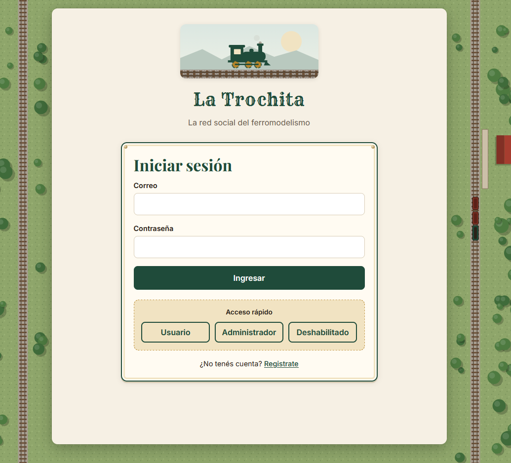
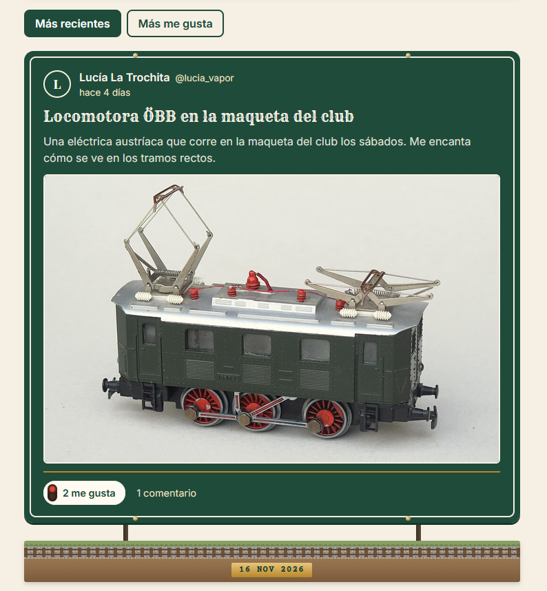
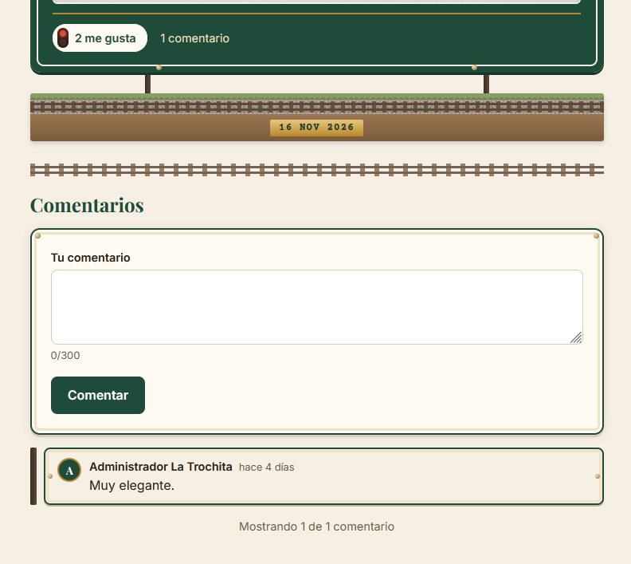
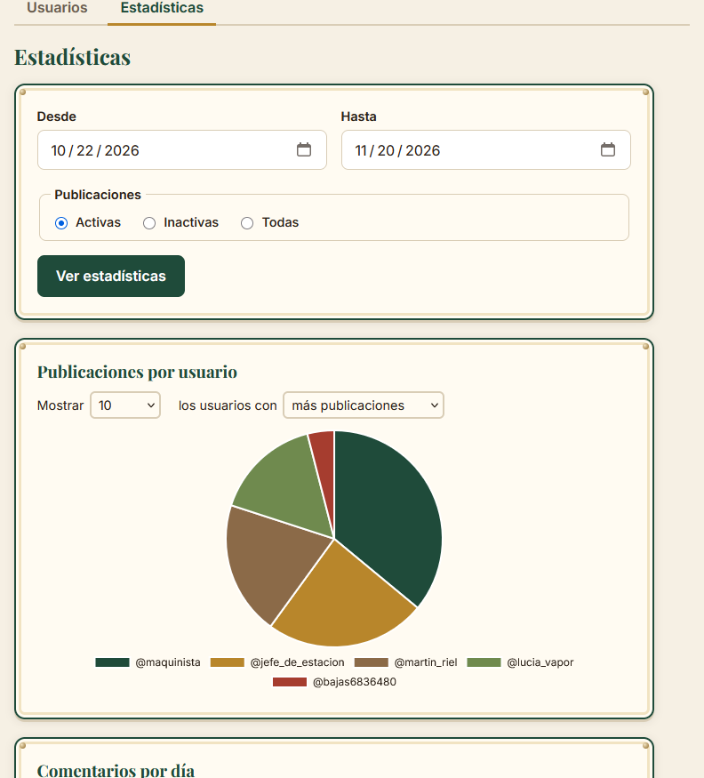
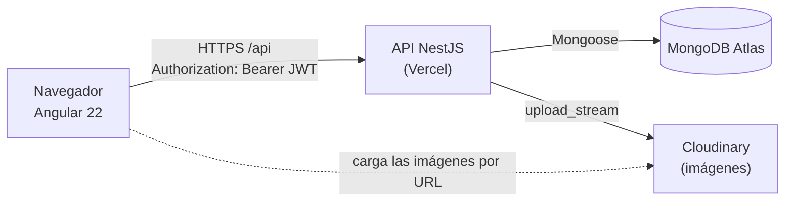

# 🚂 La Trochita

**Red social de ferromodelismo.** Los usuarios publican sus maquetas con foto, dan «me gusta» y comentan; los administradores gestionan usuarios y ven estadísticas. Hecha de punta a punta: API REST con NestJS y MongoDB, front en Angular, imágenes en Cloudinary y todo desplegado en la nube.

> Nació como el TP 2 de Programación IV (UTN FRA, 2026) y quedó como proyecto de portfolio. Detalles en [Contexto académico](#contexto-académico).

## Demo

**▶ https://front-taupe-six.vercel.app** · API: https://red-social-nu-five.vercel.app/api

La primera petición puede tardar unos segundos (arranque en frío de Vercel y Atlas). Los botones de **acceso rápido** de la pantalla de login completan el formulario:

| Cuenta | Correo | Contraseña | Para ver |
|--------|--------|------------|----------|
| Usuario | `usuario@trochita.com` | `Trochita123` | publicar, comentar, me gusta, editar el perfil |
| Administrador | `admin@trochita.com` | `Trochita123` | gráficos de estadísticas, gestión de usuarios, bajas y altas |
| Deshabilitado | `deshabilitado@trochita.com` | `Trochita123` | el aviso de cuenta dada de baja |

<!-- CAPTURAS: guardarlas en docs/img/ con estos nombres -->
<p align="center">
  
  
</p>
<p align="center">
  
  
</p>

## Stack y arquitectura

| Capa | Tecnologías |
|------|-------------|
| Front | Angular 22 (standalone, signals, Signal Forms, carga diferida), Chart.js, PWA con service worker, CSS propio |
| API | NestJS 12, Mongoose, `class-validator`, JWT, Multer, Helmet y límite de intentos (`@nestjs/throttler`) |
| Datos | MongoDB Atlas (agregaciones para las estadísticas) |
| Imágenes | Cloudinary |
| Hosting | Vercel (front y API, dos proyectos) |



```
front/    Angular: componentes, servicios, guards, interceptor, directivas y pipes propios
back/     NestJS: módulos autenticacion, usuarios y publicaciones; utilidades en src/common
docs/     capturas del README
docs-tp/  documentación del trabajo práctico
```

## Decisiones técnicas

**Autenticación con JWT y refresco**
- Login y registro devuelven un token de **15 minutos** más `emitidoEn` y `venceEn`. El front lo guarda en `localStorage` y un interceptor lo manda en `Authorization: Bearer`. Va en el header y no en una cookie, así que front y API pueden vivir en dominios distintos.
- `services/auth.ts` programa un temporizador: **a la mitad de la vida del token** (7 min 30 s) un modal con cuenta regresiva ofrece extender la sesión (`POST /autenticacion/refrescar`). Si no se extiende, se deja vencer.
- La sesión se cierra cuando la API responde **401**: el interceptor limpia la sesión, lleva al login y avisa con «Tu sesión venció». Un 403 con código `CUENTA_DESHABILITADA` hace lo mismo con su propio aviso.
- El `AuthGuard` no se queda con verificar la firma: consulta la base para comprobar que la cuenta siga existiendo y habilitada. Si un administrador da de baja a alguien, se nota en su **siguiente petición** y no cuando venza el token.
- Contraseñas con hash (`PasswordHasher` de `@nestjs/authentication`); el hash nunca sale en una respuesta.

**Validación y errores**
- DTOs con `class-validator` y un `ValidationPipe` global con `whitelist`, `forbidNonWhitelisted` y `transform`: lo que no está en el DTO se rechaza con 400, con mensajes en español.
- El front valida lo mismo con Signal Forms, y la API siempre vuelve a validar.

**Roles**
- Dos perfiles, `usuario` y `administrador`. `AuthGuard` + `SoloAdministradorGuard` protegen en la API todas las rutas de administración; en el front, guards de ruta y la directiva estructural `*appSoloAdministrador` (solo de presentación: la protección real es la de la API).

**Bajas lógicas**
- Usuarios y publicaciones **no se borran**: se marcan como dados de baja y se pueden restaurar. Al deshabilitar un usuario, el administrador elige si se ocultan también sus publicaciones, y al rehabilitarlo vuelven.

**Subida de imágenes**
- Multer en memoria, validación con un pipe (JPG, PNG o WEBP, máx. 2 MB) y envío a Cloudinary; en la base solo se guarda la URL.

**Seguridad**
- **Helmet** agrega cabeceras HTTP de seguridad. **CORS** con lista blanca de orígenes (`FRONT_URL`), nunca `*`.
- **Límite de intentos**: login y registro admiten 5 pedidos por minuto y por IP (después, 429). El contador vive en la memoria de cada instancia serverless, así que es una protección básica y no un límite global exacto; para eso haría falta un almacén compartido (Redis).
- Secretos solo en variables de entorno; `back/.env.example` documenta cuáles.

**Estadísticas**
- Tres gráficos (torta, líneas, barras) con Chart.js, alimentados por pipelines de `aggregate()` de Mongoose (`$group`, `$lookup`, `$dateToString`) con filtros de fechas, estado y ranking.

**Diseño**
- CSS propio sin librerías de estilos, con temática ferroviaria: cada publicación es una placa de estación sobre un diorama, el fondo es una maqueta con un tren que pasa, el me gusta es una señal roja/verde. Todo en SVG y CSS propios; las animaciones se apagan con `prefers-reduced-motion`.
- Directivas propias (`appBusquedaDiferida`, `appAutoOcultar`, `*appSoloAdministrador`) y pipes propios para fechas y textos.

## API

Prefijo `/api`, errores con el formato de Nest `{ statusCode, message, error }`. Los listados devuelven `{ datos, total, offset, limit }` (`limit` 5 por defecto, máximo 20).

| Método y ruta | Quién | Respuestas |
|---------------|-------|------------|
| `POST /api/autenticacion/registro` (multipart) | público | 201 · 400 · 409 · 429 |
| `POST /api/autenticacion/login` (JSON; cuenta deshabilitada: 403) | público | 200 · 400 · 401 · 403 · 429 |
| `POST /api/autenticacion/autorizar` (devuelve usuario, `emitidoEn` y `venceEn` del mismo token) | con token | 200 · 401 |
| `POST /api/autenticacion/refrescar` (token nuevo de 15 min) | con token | 200 · 401 |
| `GET /api/usuarios/yo` | con token | 200 · 401 |
| `PATCH /api/usuarios/yo` (multipart; no admite correo, perfil ni activo) | el propio usuario | 200 · 400 · 401 · 409 |
| `GET /api/usuarios/:id` (perfil público) | con token | 200 · 400 · 404 |
| `GET /api/usuarios?offset=&limit=&buscar=` (`buscar`: texto en el correo o el nombre de usuario; con `perfil` y `activo`) | administrador | 200 · 400 · 401 · 403 |
| `POST /api/usuarios` (multipart: campos del registro + `perfil`) | administrador | 201 · 400 · 401 · 403 · 409 |
| `DELETE /api/usuarios/:id?ocultarPublicaciones=true\|false` (baja lógica) | administrador, no a sí mismo | 200 · 400 · 401 · 403 · 404 · 409 |
| `POST /api/usuarios/:id/rehabilitar` (vuelven las publicaciones ocultadas) | administrador | 200 · 400 · 401 · 403 · 404 · 409 |
| `POST /api/publicaciones` (multipart) | con token | 201 · 400 · 401 |
| `GET /api/publicaciones?orden=&usuario=&offset=&limit=` | con token | 200 · 400 · 401 |
| `GET /api/publicaciones/:id` | con token | 200 · 400 · 401 · 404 |
| `GET /api/publicaciones?usuario=&incluirBajas=true` (también las dadas de baja, con `estado`) | administrador | 200 · 400 · 401 · 403 |
| `GET /api/estadisticas/publicaciones-por-usuario`, `/comentarios-por-dia`, `/comentarios-por-publicacion` (query `desde`, `hasta` en `AAAA-MM-DD`, `estado` = `activas`\|`inactivas`\|`todas`; los rankings suman `cantidad` = `5`\|`10`\|`15`\|`todos` y `orden` = `mayor`\|`menor`, y comentarios por publicación `incluirSinComentarios`) | administrador | 200 · 400 · 401 · 403 |
| `POST /api/publicaciones/:id/restaurar` (dar de alta otra vez) | administrador | 200 · 400 · 401 · 403 · 404 · 409 |
| `DELETE /api/publicaciones/:id` (baja lógica) | autor o administrador | 204 · 400 · 403 · 404 |
| `POST` y `DELETE /api/publicaciones/:id/me-gusta` | con token | 201 / 200 · 400 · 404 · 409 |
| `GET /api/publicaciones/:id/comentarios?offset=&limit=` (más recientes primero) | con token | 200 · 400 · 401 · 404 |
| `POST /api/publicaciones/:id/comentarios` (JSON `{ mensaje }`, 1 a 300 caracteres) | con token | 201 · 400 · 401 · 404 |
| `PUT /api/publicaciones/:id/comentarios/:comentarioId` (marca `modificado` si el mensaje cambió) | el autor | 200 · 400 · 401 · 403 · 404 |

Los listados devuelven `{ datos, total, offset, limit }` (`limit` 5 por defecto, máximo 20).

### Rutas del front

| Ruta | Acceso | Pantalla |
|------|--------|----------|
| `/login`, `/registro` | sin sesión | Login (con acceso rápido) y registro |
| `/publicaciones`, `/perfil` | con sesión | Listado (orden, paginación, crear, me gusta y eliminar) y mi perfil |
| `/publicaciones/:id` | con sesión | Una publicación, comentarios paginados y edición de los propios |
| `/usuarios/:id` | con sesión | Perfil público de otro usuario |
| `/dashboard/estadisticas` | administrador | Tres gráficos con filtros |
| `/dashboard/usuarios`, `/dashboard/usuarios/nuevo` | administrador | Planilla paginada, alta, deshabilitar y rehabilitar |

## Cómo correrlo localmente

Requisitos: Node 22 o superior, una base en MongoDB Atlas (o local) y una cuenta gratuita de Cloudinary.

```bash
# API
cd back
npm install
cp .env.example .env      # completar MONGO_URI, JWT_SECRET y las claves de Cloudinary
npm run seed              # cuentas de acceso rápido y publicaciones de ejemplo (se puede repetir sin duplicar)
npm run start:dev         # http://localhost:3000/api

# Front (en otra terminal)
cd front
npm install
npm start                 # http://localhost:4200
```

`npm run build` compila cada parte. La URL de la API del front está en `front/src/environments/`.

## Despliegue

Dos proyectos de **Vercel** del mismo repositorio (*Root Directory* `back` y `front`), base en **MongoDB Atlas** e imágenes en **Cloudinary**. Se despliega solo con cada push.

- **API:** variables `MONGO_URI`, `JWT_SECRET`, `CLOUDINARY_CLOUD_NAME`, `CLOUDINARY_API_KEY`, `CLOUDINARY_API_SECRET`, `IMAGEN_PERFIL_DEFECTO` y `FRONT_URL` (admite varias URLs separadas por coma). Atlas permite `0.0.0.0/0` porque Vercel no tiene IP fija; es una limitación conocida de este tipo de despliegue.
- **Front:** el build de producción reemplaza `environment.ts` por `environment.production.ts`; `front/vercel.json` manda todas las rutas a `index.html`. *Output Directory*: `dist/front/browser`.

## Qué mejoraría

- Tests automáticos: e2e de autenticación y publicaciones en la API.
- Integración continua con GitHub Actions (build y tests en cada push).
- Límite de intentos con almacén compartido (Redis) y *refresh token* en cookie `httpOnly`, en lugar del token en `localStorage`.

## Contexto académico

Proyecto individual del **TP 2 de Programación IV** (UTN FRA, 2026 C2), aprobado. Se desarrolló por sprints; el estado de cada requerimiento está en [docs-tp/REQUERIMIENTOS.md](docs-tp/REQUERIMIENTOS.md).

#### Origen de las tecnologías

| Pieza | Origen |
|-------|--------|
| NestJS, Mongoose, `class-validator`, `@nestjs/config`, `@nestjs/jwt`, `PasswordHasher`, `@nestjs/mapped-types`, Cloudinary + Multer | clase |
| Guard que lee el header `Authorization` (en clase leía la cookie) | clase, con cambios |
| Excepciones HTTP de Nest en lugar de `throw new Error` | clase, con cambios |
| `aggregate()` de Mongoose (`$group`, `$lookup`, `$dateToString`) para las estadísticas | clase, con cambios (en clase se usó `find`; acá hay que agrupar y contar) |
| Script de seed | nuevo |
